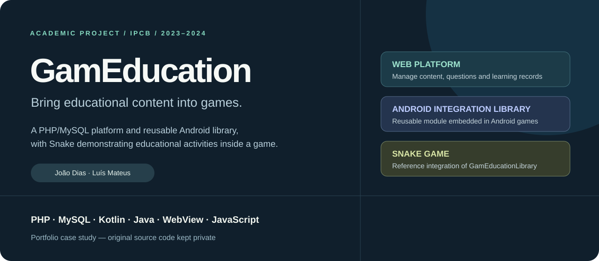
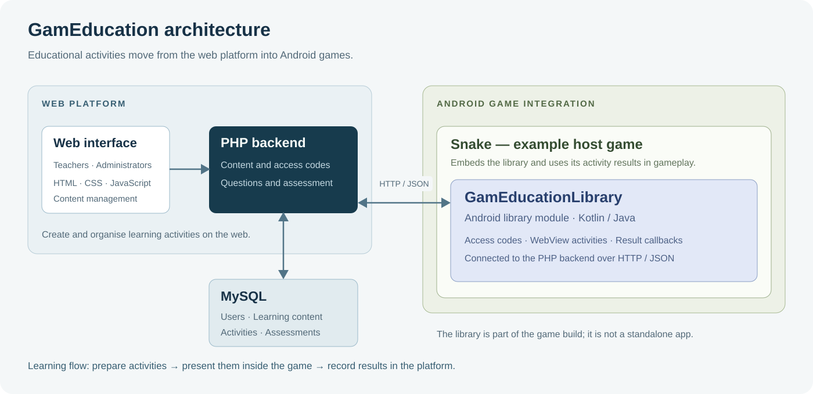

# GamEducation

**A web platform and Android integration library for game-based learning.**

[Português](README.pt-PT.md) · [Project overview](#project-overview) · [Technologies](#technologies) · [My contribution](#my-contribution)

| Context | Details |
| --- | --- |
| Institution | Instituto Politécnico de Castelo Branco, Portugal |
| Programme | Computer Engineering |
| Period | 2023–2024 |
| Project type | Final-year academic project |
| Team | Two student co-developers: João Dias and Luís Mateus |
| My role | Co-developer of the web platform, Android library and game integration |
| Source availability | Private; this repository contains the project presentation |

## Project overview

GamEducation connects teacher-managed learning material with Android games. Its core integration combines a PHP/MySQL web platform with `GamEducationLibrary`, a reusable Android library module embedded in games. Snake demonstrates how a game can use that library.

Teachers can organise learners and groups, prepare questions and educational content, and associate activities with games through access codes. During gameplay, the integration library presents educational activities and returns results through callbacks that the game can use.

## What we built

### Web platform

- Workflows for teachers, administrators and game developers.
- Management of learners, groups and content categories.
- Creation of educational content, questions and questionnaires.
- Question formats including multiple choice, true/false, multiple answers, matching, ordering and fill-in-the-blank.
- Access codes linking educational activities to games.
- Assessment records and game issue reporting.

### Android integration library

- `GamEducationLibrary` is built as an Android library module with Kotlin and Java and included as a dependency in the Snake game.
- Handles access-code entry and validation against the PHP backend.
- Presents educational content and questions inside the game through WebView.
- Uses a JavaScript bridge and callbacks to return activity results to the host game.
- Communicates with the web platform over HTTP/JSON.

### Snake example game

- Android Snake game with progression and reward mechanics.
- Embeds the library and requests educational activities at points in gameplay.
- Uses activity results to decide how play resumes or rewards are applied.

## Architecture

The web interface lets teachers prepare learning activities. The PHP backend serves the activity and access-code workflows and uses MySQL to store users, content, game links and assessments.

Within Snake, `GamEducationLibrary` manages the educational interaction: it obtains the activity from PHP, presents it in WebView and returns the result to the game through a callback. The game remains responsible for its own gameplay and reward decisions.

Snake launches directly and uses the library for access-code entry, activity presentation and result callbacks. This integration requires the PHP/MySQL backend, but does not require a separate GamEducation Android app to be installed.

## Earlier Android implementation

The source history also retains a standalone Kotlin/Jetpack Compose Android application. It represents an earlier integration approach. The later Snake implementation embeds the library, handles educational interactions within the game and does not call that app. It is therefore kept as development context rather than part of the main architecture above.

## Technologies

| Area | Technologies | How they were used |
| --- | --- | --- |
| Backend | PHP | Application workflows, content access and assessment endpoints |
| Database | MySQL, SQL | Relational modelling of learning content, users, groups and assessments |
| Web interface | HTML, CSS, JavaScript, Bootstrap | Management pages and educational interactions |
| Earlier Android implementation | Kotlin, Jetpack Compose | Standalone Android screens retained in the source history; not required by the library-based Snake integration |
| Android integration | Kotlin, Java, WebView, JavaScript bridge | Reusable library module, educational activities and callbacks to the host game |
| Communication | HTTP, JSON, OkHttp, Gson | Data exchange between Android components and PHP |
| Development workflow | Git, GitHub, Gradle, Android Studio | Collaborative development and Android project tooling |

## My contribution

I co-developed GamEducation with my project colleague Luís Mateus. We worked jointly across the PHP/MySQL platform, Android library and Snake integration, as well as the earlier Android implementation.

My hands-on experience from the project includes implementing web and Android functionality, working with the relational data model, connecting components through HTTP/JSON and developing educational interactions within a game integration. Design and implementation decisions were made collaboratively.

## Engineering experience

- Connecting web and Android components with different UI and runtime environments.
- Modelling relationships between educational content, questions, learners and game activity.
- Handling several question formats and their associated response workflows.
- Building a reusable Android integration layer alongside a working game example.
- Coordinating shared implementation work in a two-person academic team.

## Project outcome

The library-based academic implementation consists of a web learning platform, a reusable Android integration library and a Snake example game. It provided practical experience across backend, relational databases, web interfaces, Android UI, library modules and game integration.

## Authors and availability

Co-developed by [João Dias](https://github.com/JoaoDias28) and [Luís Mateus](https://github.com/luismateus10) in the Computer Engineering programme at the Instituto Politécnico de Castelo Branco.

The original source code is kept private. This presentation contains an overview and explanatory diagrams, without application source, database exports or user records. I can discuss the architecture, technical decisions and collaborative contribution in an interview.
